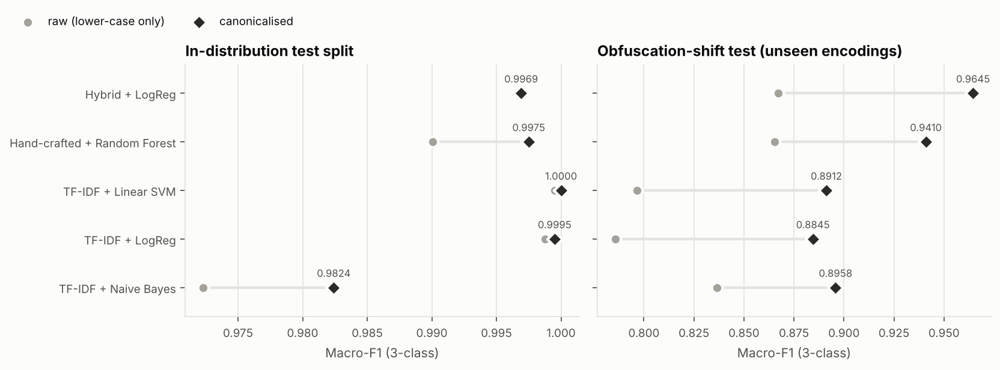
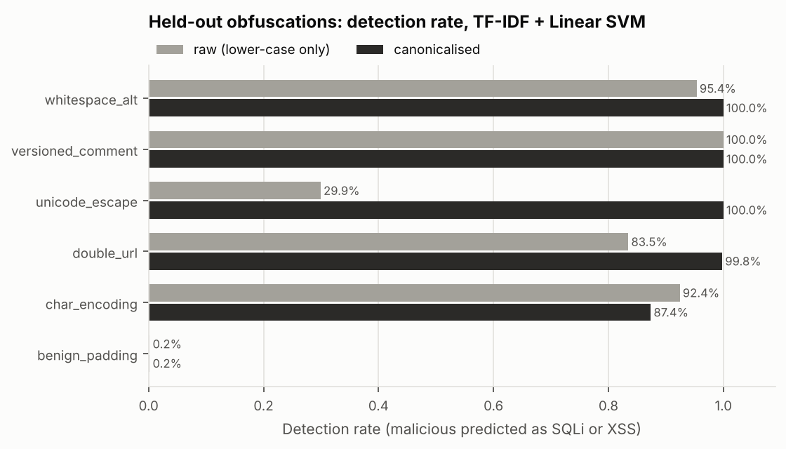
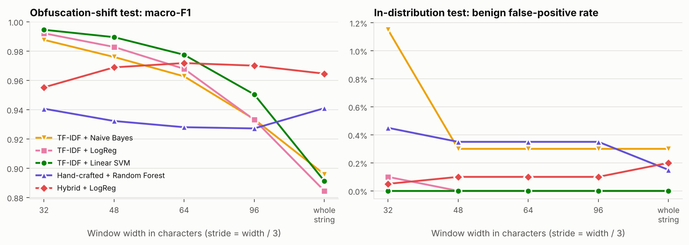
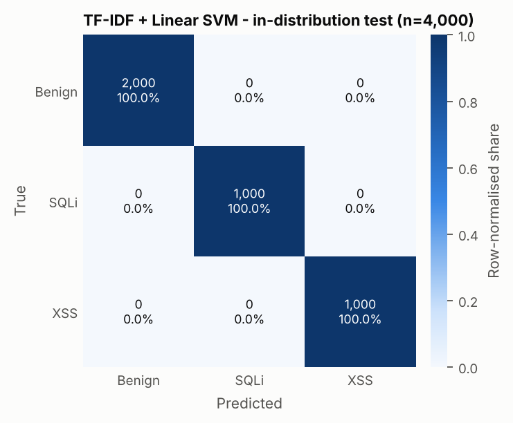
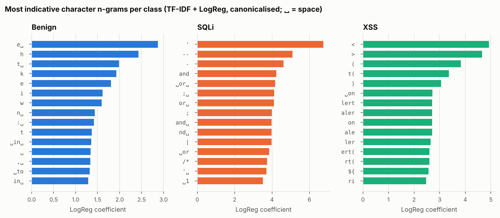
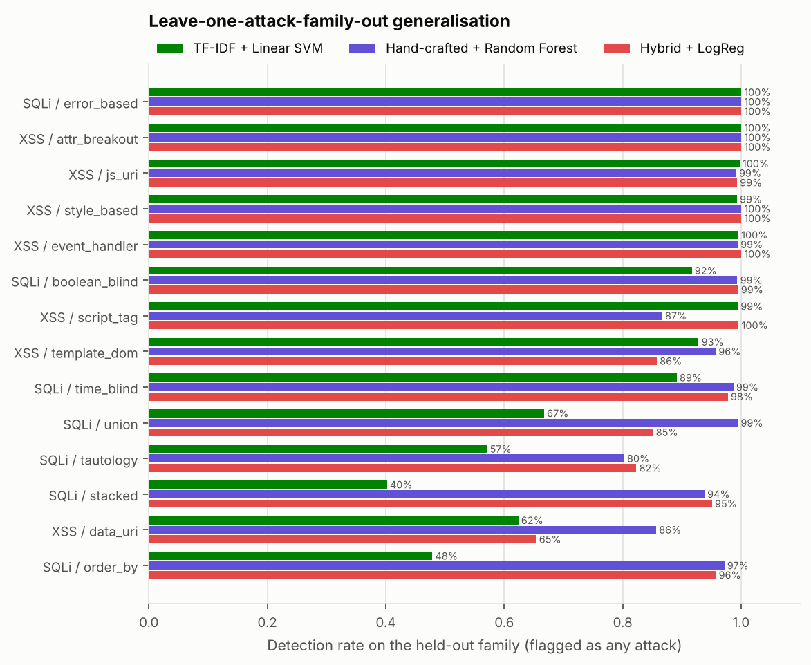

# ML Detection of SQL-Injection and XSS Payloads

A self-contained, reproducible research mini-project that classifies web-request
strings (query parameters, form fields) as **benign**, **SQL injection (SQLi)**
or **cross-site scripting (XSS)**. It compares character n-gram TF-IDF models
with hand-crafted lexical features. It then tests them under conditions where
a detector usually fails: **encodings it never saw**, **attack families it never
saw**, and **benign-padding (mimicry) evasion**.

The write-up is in [`paper/paper.md`](paper/paper.md).

> **Safety.** Every payload in this repository is an *inert string*. No code here
> sends a payload to a server, renders it in a browser, passes it to a database
> driver, or evaluates it. Canonicalisation (URL/HTML/JS decoding) returns a
> Python `str` and nothing more. JavaScript in the XSS samples is limited to
> harmless markers (`alert(1)`, `console.log(…)`, `print()`), and external hosts
> use the reserved `.example`/`.test` TLDs (RFC 2606). The payload patterns are
> textbook examples of the kind published in OWASP testing material, used here
> only to train and test a defensive classifier.

---

## Headline results

All numbers come from `results/` and are produced by one command (see
[Reproduce](#reproduce)).

| Setting (canonicalised input) | Best model | Macro-F1 | Benign FPR |
|---|---|---|---|
| E1 In-distribution 80/20 split (n = 4,000) | TF-IDF + Linear SVM | **1.0000** | 0.00 % |
| E2 5-fold CV (mean ± sd) | TF-IDF + Linear SVM | 0.9998 ± 0.0002 | 0.01 % |
| E3 Unseen obfuscations (n = 4,857) | Hybrid + LogReg | **0.9645** | 0.20 % |
| E3 + sliding window (w = 48) | TF-IDF + Linear SVM | **0.9895** | 0.00 % |
| E5 Unseen attack family (mean detection over 14 families) | Hand-crafted + RF | 95.4 % detected | 0.16 % |

What we found:

1. **In-distribution scores are close to perfect, so they tell us little.** All
   TF-IDF models score ≥ 0.98 macro-F1 on a random split of synthetic data.
2. **Canonicalisation matters more than the choice of classifier.** On unseen
   encodings it raises macro-F1 by 0.06 to 0.10 for every model (e.g. Linear
   SVM 0.797 → 0.891). Unicode-escape detection goes from 29.9 % to 100 %.
3. **Benign padding defeats whole-string TF-IDF.** Detection of padded payloads
   falls to 0.2 % for both the Linear SVM and LogReg models. The cause is L2
   normalisation, which dilutes the attack n-grams. Max-pooling over 48-char
   sliding windows restores it to 96.2 % without raising the false-positive rate.
4. **Hand-crafted features generalise better to new attack families.** When a
   whole family is left out of training, the Random Forest still detects
   95.4 % of it on average. The Linear SVM detects 81.8 %, and only 40 % of
   the unseen *stacked-query* SQLi.
5. **A dataset shortcut showed up.** The most important hand-crafted feature is
   `upper_ratio_raw`, because synthetic SQLi is mostly written in upper case.
   The paper discusses this.

| | | |
|---|---|---|
|  |  |  |
|  |  |  |

---

## Threat model

**Asset.** A web application that reads untrusted HTTP parameters. Some reach
SQL queries and some reach HTML responses.

**Defender.** A detector in front of the application, at the position of a WAF
or of the input-validation layer. It sees each parameter value as a string,
optionally after canonicalisation. It answers *benign / SQLi / XSS*, and a
malicious verdict can block the request, log it or raise an alert. The
detector is an extra layer. It does not replace parameterised queries or
context-aware output encoding.

**Attacker.** A remote, unauthenticated client who fully controls parameter
values. The attacker wants a working SQLi or XSS payload to pass the detector.
We consider an attacker who can:

| Capability | Modelled by |
|---|---|
| use standard payload families | 7 SQLi + 7 XSS template families |
| apply known encodings and obfuscations | seen obfuscations (case mixing, `/**/` whitespace, URL encoding, HTML entities, `/` tag separators) |
| use encodings the defender never trained on | E3 held-out obfuscations: double URL encoding, `%09`/`%0a` whitespace, MySQL `/*!…*/`, `\uXXXX`, `CHAR()`/`fromCharCode`, benign padding |
| use an attack *class* never seen in training | E5 leave-one-family-out |
| bury a payload inside innocuous text (mimicry) | `benign_padding` obfuscation |

**Out of scope.** The following are not modelled:

* Adaptive attackers with query access who optimise against a specific model
  (e.g. WAF-A-MoLE-style mutation search).
* Second-order and stored injection.
* Payloads split across several parameters.
* Non-HTTP channels.
* Ground-truth exploitability: a string is labelled malicious by construction,
  whether or not it would succeed against a particular backend.

**Errors and their costs.** A false negative lets an attack through. A false
positive blocks a legitimate user. For that reason we report the benign
false-positive rate separately. We also report it on a *hard-benign* subset:
inputs that contain SQL/HTML words, quotes, `=` or `<`, such as
`how to use union select in mysql`, `O'Brien` or `a < b && b > c`.

---

## Design

```
raw string ──► canonicalize() ──┬──► char 1–4-gram TF-IDF ──► NB / LogReg / LinearSVM
  (inert)     URL-decode ×3     │
              HTML-unescape     ├──► 28 hand-crafted features ──► Random Forest
              \uXXXX / \xXX     │
              /*!…*/ unwrap     └──► TF-IDF ⊕ scaled hand-crafted ──► LogReg (hybrid)
              /**/ → space
              lower-case
                                  optional: WindowedDetector (max-pool over sliding windows)
```

* **Canonicalisation** (`src/preprocessing.py`) follows the idea of
  ModSecurity transformation functions (`t:urlDecodeUni`, `t:htmlEntityDecode`,
  `t:jsDecode`, `t:replaceComments`, `t:compressWhitespace`, `t:lowercase`).
  Every experiment is also run with *raw* (lower-case only) input as an
  ablation.
* **TF-IDF** (`src/features.py`) uses `analyzer="char"` rather than
  `"char_wb"`, because attack syntax crosses word boundaries (`1=1--`,
  `'><scr`). It uses 1–4-grams, sublinear TF, `min_df=2` and at most 50k
  features.
* **Hand-crafted features** (`src/features.py`, 28 in total):
  * length (raw and canonical) and token count;
  * special-character, digit, upper-case and whitespace ratios;
  * Shannon entropy;
  * percent-encoding ratio, HTML-entity count and JS-escape count;
  * counts of quotes, `<>`, `()`, `=`, `;` and SQL comment markers;
  * SQL- and XSS-keyword counts;
  * regex flags for HTML tags, event handlers, `javascript:` URIs, tautologies
    and `UNION SELECT`;
  * function-call count, longest non-alphanumeric run and quote imbalance.

  Encoding indicators are always computed on the raw string, because the
  encoding itself is evidence.
* **Models** (`src/models.py`). Each model is one scikit-learn `Pipeline`, so
  vocabulary, IDF and scaling are fitted on training folds only:

  | key | model |
  |---|---|
  | `tfidf_nb` | TF-IDF + Multinomial NB (baseline) |
  | `tfidf_lr` | TF-IDF + Logistic Regression (C = 10) |
  | `tfidf_svm` | TF-IDF + Linear SVM (C = 1) |
  | `hand_rf` | hand-crafted features + Random Forest (300 trees) |
  | `hybrid_lr` | TF-IDF ⊕ log-scaled, standardised hand-crafted features + LogReg |

* **3-class and binary views.** Models are trained as 3-class classifiers. The
  binary *malicious vs benign* metrics (precision, recall, FPR, ROC-AUC) come
  from merging SQLi and XSS, with score = 1 − P(benign) or the margin
  difference for the SVM.
* **Sliding-window inference** (`src/windowed.py`) wraps any fitted model. It
  scores overlapping windows of the canonical string and keeps the most
  malicious one. No retraining is needed.

## Dataset

`data/payloads.csv` has 20,000 unique rows: 10,000 benign, 5,000 SQLi and
5,000 XSS. `src/data_generation.py` generates it deterministically (seed 42),
and every run regenerates it and checks it against the committed file.

| Column | Meaning |
|---|---|
| `text` | the request string (inert) |
| `label` | `benign` / `sqli` / `xss` |
| `family` | generator family: 20 benign families (search, name, email, password, tech_question, …), 7 SQLi families (tautology, union, error_based, stacked, time_blind, boolean_blind, order_by) and 7 XSS families (script_tag, event_handler, js_uri, attr_breakout, data_uri, template_dom, style_based) |
| `obfuscation` | `none`, 5 *seen* families, or 6 *held-out* families (see threat model) |
| `context` | `raw` value, `param=value`, or `multi_param` query string |
| `hard_benign` | benign input that contains SQL/HTML vocabulary or special characters (3,356 rows) |

The generator works in three steps:

1. Draw a base string from a family template with random fills (prefix
   quotes, comment terminators, tables, columns, marker calls).
2. Apply one obfuscation:
   * Malicious rows are plain 40 % of the time; the rest use one of 11
     transforms, with seen and held-out transforms weighted 3 : 2.
   * Benign rows are URL-encoded 15 % of the time and entity-encoded 3 % of
     the time, so `%` and `&#` are not giveaways.
3. Wrap the string in a parameter context. The probabilities are the same for
   every class: 65 % raw, 25 % `param=`, 10 % multi-param.

Exact duplicates are dropped. `results/dataset_summary.csv` lists counts per
family, obfuscation and context, plus length statistics.

## Experiments

| ID | Question | Protocol |
|---|---|---|
| E1 | How well do the models do in-distribution? | Stratified 80/20 split; every model × {canonical, raw} |
| E2 | How much does performance vary? | 5-fold stratified CV, canonical |
| E3 | Do the models withstand encodings they never saw? | Train on benign-train + malicious with *seen* obfuscations; test on benign-test + malicious with *held-out* obfuscations; × {canonical, raw} |
| E4 | Does sliding-window inference defeat padding? | E1/E3 canonical models re-scored with widths 32/48/64/96 |
| E5 | Do the models generalise to unseen attack families? | For each of the 14 families: train without it (E1 train split), test on all its rows plus E1 benign-test |

## Reproduce

```bash
python -m venv .venv && source .venv/bin/activate
```

```bash
pip install -r requirements.txt
```

```bash
python -m src.run_experiments
```

The full run takes about 6–7 minutes on 4 cores. `--quick` skips the
cross-validation step.

```bash
python -m unittest discover -s tests
```

The pipeline was checked by running it twice from a clean virtualenv built
from `requirements.txt` (Python 3.13). Every file in `data/` and `results/`
was byte-identical across the two runs, except `results/timing.csv`, which
records wall-clock times.

Classify your own strings. On first use this trains and caches a model in the
git-ignored `models/` directory:

```bash
python -m src.predict "id=1' OR 1=1--" "<svg onload=alert(1)>" "how to use union select in mysql"
```

```bash
python -m src.predict --model tfidf_svm --window 48 "long review text ... payload ... more text"
```

## Repository layout

```
src/
  config.py            paths, seed, sizes, obfuscation split
  data_generation.py   synthetic dataset (templates, obfuscations, contexts)
  preprocessing.py     WAF-style canonicalisation
  features.py          char n-gram TF-IDF + 28 hand-crafted features
  models.py            model zoo (sklearn Pipelines) + malicious score
  windowed.py          sliding-window max-pool detector
  evaluate.py          3-class + binary metrics, per-group recall
  plots.py             all figures
  run_experiments.py   E1–E5 end-to-end
  predict.py           CLI classifier
data/payloads.csv      generated dataset
results/               metrics.csv, cv_metrics.csv, window_sweep.csv,
                       family_holdout.csv, obfuscation_detection.csv,
                       feature_importance.csv, top_ngrams.csv,
                       confusion_matrices.json, misclassified_*.csv,
                       classification_report.txt, summary.json, figures/
paper/paper.md         research paper
tests/                 unittest sanity checks
```

## Limitations (short version)

* **The data is synthetic.** Template-generated payloads share surface
  structure, which pushes in-distribution scores towards 100 %. E3 and E5 are
  the more informative tests.
* **The model learned a shortcut.** SQL keyword case is a strong cue in this
  dataset, and real traffic may not have it.
* **The class balance is unrealistic.** Benign requests are 50 % of the data
  here, while in production they are far more than 99.9 %. A 0.2 % FPR would
  produce many alerts at that base rate.
* **The attackers are not adaptive.** No attacker in these experiments
  optimises against the model.

The paper (§5) discusses each of these points.
