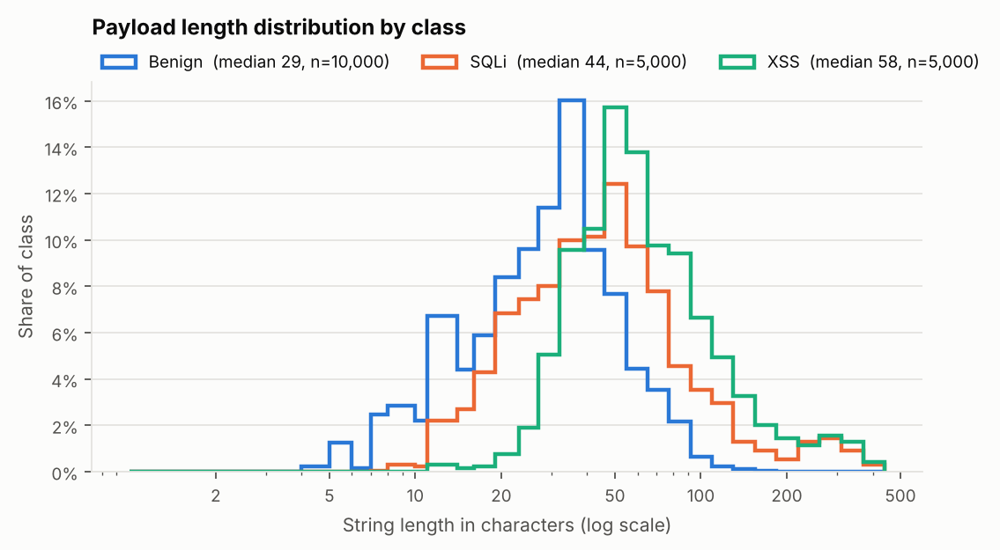
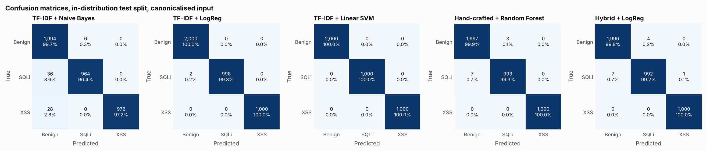
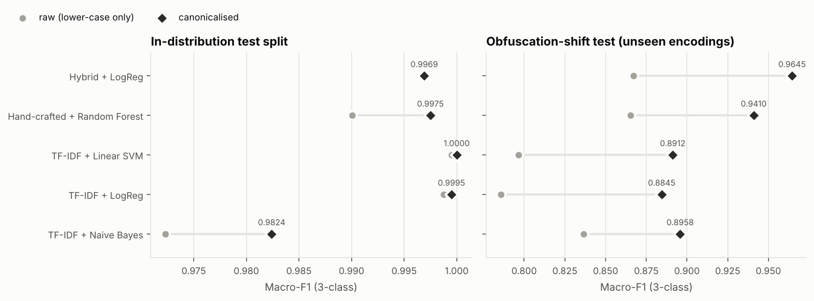
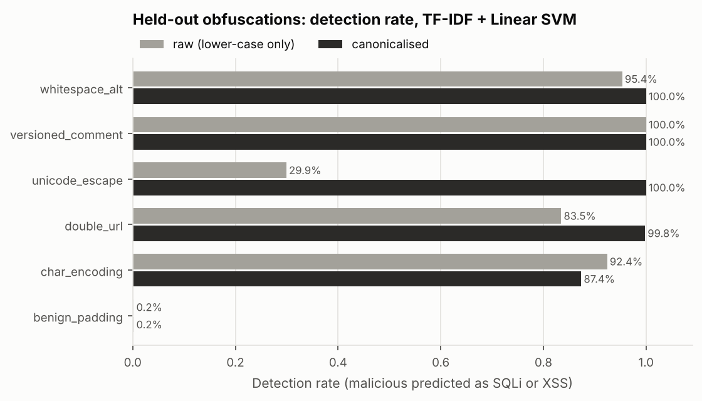
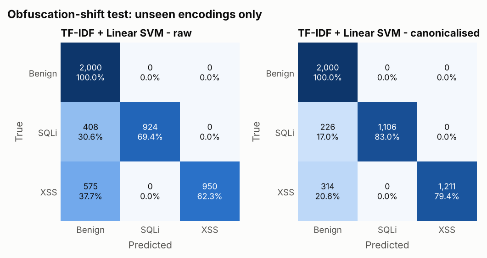
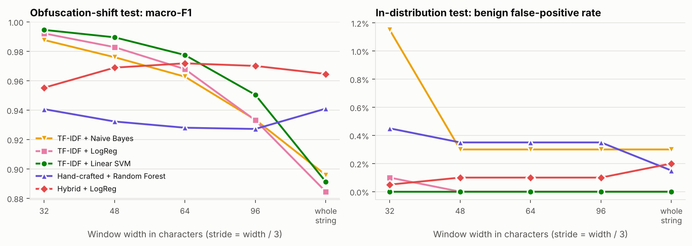
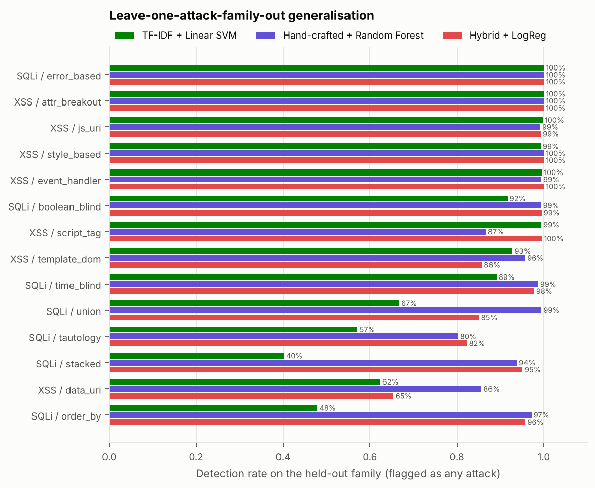
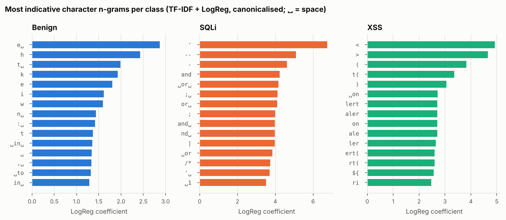
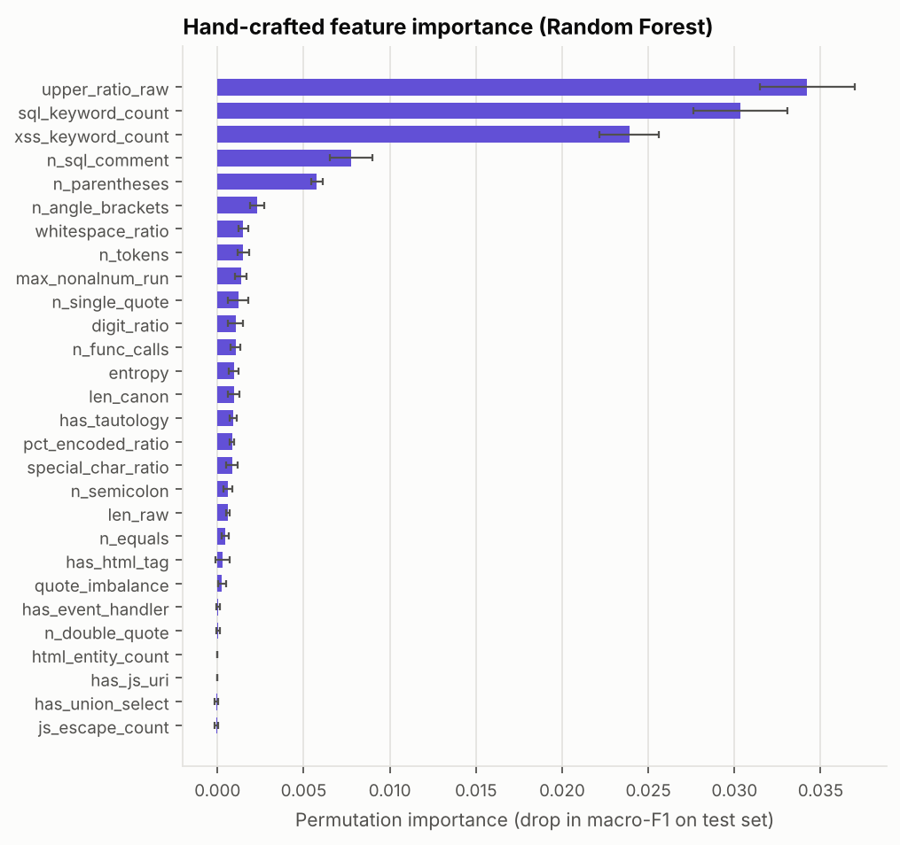

# Beyond the Random Split: Robustness of Character n-gram and Hand-crafted-Feature Classifiers for SQL-Injection and XSS Payload Detection

*Research mini-project — reproducible code, data and results in this repository.*

---

## Abstract

SQL injection (SQLi) and cross-site scripting (XSS) are still among the most
common web-application attacks. Machine-learning (ML) detectors are often
proposed as a complement to signature-based web application firewalls (WAFs).
This paper builds a reproducible benchmark. It contains 20,000 synthetic
web-request strings: 10,000 benign, 5,000 SQLi and 5,000 XSS. The strings
cover 14 attack families and 11 obfuscation techniques, and 3,356 benign
strings are "hard" because they contain SQL or HTML vocabulary. We compare
five three-class classifiers. Three use character 1–4-gram TF-IDF (Naive
Bayes, logistic regression, linear SVM). One is a random forest on 28
hand-crafted lexical features. One is a hybrid of both representations.

On a stratified random split every TF-IDF model exceeds 0.98 macro-F1, and
the linear SVM classifies all 4,000 test strings correctly. This ceiling hides
large differences in robustness, which three harder protocols reveal:

* **Obfuscations held out from training.** Macro-F1 falls to 0.79–0.87 on raw
  input. WAF-style canonicalisation recovers 0.06–0.10 macro-F1 for every
  model. The hybrid model is best (0.9645).
* **Benign padding.** Wrapping a payload in innocuous prose cuts whole-string
  TF-IDF detection to at most 0.2 %. Max-pooling the classifier over 48-character
  sliding windows restores it to 96.2 % and adds no false positives. The
  linear SVM then reaches 0.9895 macro-F1 on the shift test.
* **Unseen attack families.** When a whole family is left out of training,
  hand-crafted features detect 95.4 % of it on average. The best TF-IDF model
  detects 81.8 %.

We also report a shortcut: SQL keyword capitalisation is the single most
important hand-crafted feature. All payloads are inert strings, and the full
pipeline regenerates every number and figure in this paper with one command.

---

## 1 Introduction

Injection flaws have appeared in the OWASP Top 10 in every edition. In 2021
they ranked third, and XSS is now counted in the same category [1]. Two attack
types dominate:

* **SQL injection** places attacker-controlled text inside a database query.
  It can bypass authentication, leak or modify data and, in some
  configurations, execute operating-system commands [2, 3].
* **Cross-site scripting** places attacker-controlled markup or script in a
  page that a victim renders. It can steal sessions and perform actions in the
  victim's name [4].

The primary defences are well known: parameterised queries and context-aware
output encoding. However, legacy code, third-party components and
configuration mistakes leave gaps. Organisations therefore deploy web
application firewalls (WAFs), which inspect requests before they reach the
application. ModSecurity with the OWASP Core Rule Set (CRS) is the canonical
open-source example [5, 6]. Signature WAFs are effective against known
patterns, but they have two weaknesses. They are brittle against
obfuscation [7, 8], and they produce false positives on legitimate input that
merely *looks* like code.

ML classifiers trained on payload strings promise to generalise beyond
hand-written signatures, and they have been studied extensively, from token
graphs with SVMs [9] to deep networks [10]. Many published evaluations have
three things in common:

* a random train/test split of a single dataset;
* accuracy above 99 %;
* little analysis of what happens when the attacker does something the
  training data did not contain.

Arp et al. [11] list exactly these practices (sampling bias, data snooping,
lab-only evaluation) among the most common pitfalls of ML in security.

This project asks a narrower question that a practitioner can act on: **which
design choices make a payload classifier robust when the attacker changes
encoding, attack family or surrounding text?** We contribute:

1. **A documented synthetic dataset.** It has 20,000 strings, with
   per-sample labels for attack family, obfuscation technique, parameter
   context and a "hard benign" flag. All payloads are inert and the generator
   is deterministic.
2. **A controlled comparison of five classifiers.** The classifiers use
   character n-gram TF-IDF, hand-crafted features or both. They are trained
   for 3-class classification (benign/SQLi/XSS) and also evaluated as binary
   detectors.
3. **Three robustness protocols beyond the random split:**
   * *obfuscation shift*: six encodings never seen in training;
   * *benign-padding mimicry*;
   * *leave-one-attack-family-out*.
4. **Two inexpensive defences, measured.** WAF-style canonicalisation, and
   sliding-window max-pooling against padding. We also report an honest
   account of failure modes and of a dataset shortcut.

## 2 Background

### 2.1 Injection attacks

**SQLi.** An SQLi payload breaks out of the data context of a query, usually
by closing a string literal with a quote or by ending a numeric expression.
It then appends SQL syntax. Halfond et al. [2] classify the main techniques,
and we use the same families:

| Family | What it does | Example |
|---|---|---|
| Tautology | makes a condition always true | `' OR 1=1--` |
| UNION-based | appends a second result set | `' UNION SELECT username,password FROM users--` |
| Error-based | leaks data through DBMS error messages | `extractvalue`, `updatexml`, type-conversion errors |
| Piggy-backed (stacked) | adds a second statement | `; DROP TABLE …` |
| Blind (boolean) | infers data one bit at a time from responses | `AND SUBSTRING(…)='a'` |
| Blind (time-based) | infers data from response delays | `SLEEP`, `WAITFOR DELAY`, `pg_sleep`, `BENCHMARK` |
| Column probing | finds the number of columns for a UNION | `ORDER BY n` |

Comment sequences (`--`, `#`, `/*`) remove the remainder of the original query.

**XSS.** An XSS payload breaks out of an HTML text, attribute, URL or
JavaScript context and introduces executable script. Common vectors:

* ``. The canonical
   n-gram models have learned `alert(`/`aler` as strong XSS evidence
   (Section 4.5), so when those n-grams disappear the evidence goes with them.
   The hand-crafted RF still detects 99.8 %, from structural features such as
   tags, parentheses and function calls.
2. *Benign padding.* Detection is 0.0–0.2 % for all three TF-IDF models,
   whatever the preprocessing. The payload is intact in the string, but
   2–5 surrounding review sentences dominate the L2-normalised TF-IDF
   vector. This is the n-gram analogue of the "good word" attack on spam
   filters [21]. The hand-crafted RF (44.8 %) and the hybrid (66.9 %) resist
   partly, because count features such as `n_sql_comment`, `n_parentheses`
   and the keyword counts are not normalised by length.

Padding accounts for nearly all of the TF-IDF loss in E3. Excluding the 480
padded strings, canonical SVM recall on the other five held-out techniques is
97.4 %.

**Ranking survives better than thresholding for the Random Forest.** Its E3
ROC-AUC is 0.9998, while its binary recall is only 0.896. The model still
ranks padded and encoded attacks above benign inputs, but their scores fall
below the 0.5 threshold. A threshold recalibrated on shifted data would
recover much of the loss; the TF-IDF models do not have this property
(AUC 0.84–0.97).

*Figure 5. E3 confusion matrices for the Linear SVM with raw and canonical
input. Every error is an attack predicted as benign. Confusion between
SQLi and XSS does not occur.*

### 4.3 E4 – Sliding-window inference against padding

| Model | Window | E3 macro-F1 | E3 bin. recall | E3 padding detected | E3 FPR | E1 macro-F1 | E1 FPR |
|---|---|---|---|---|---|---|---|
| TF-IDF + Naive Bayes | whole | 0.8958 | 0.8316 | 0.0 % | 0.45 % | 0.9824 | 0.30 % |
| TF-IDF + Naive Bayes | 32 | 0.9877 | 0.9909 | 94.6 % | 0.95 % | 0.9943 | 1.15 % |
| TF-IDF + Naive Bayes | 48 | 0.9759 | 0.9709 | 82.7 % | 0.45 % | 0.9985 | 0.30 % |
| TF-IDF + Naive Bayes | 64 | 0.9627 | 0.9527 | 71.9 % | 0.45 % | 0.9982 | 0.30 % |
| TF-IDF + Naive Bayes | 96 | 0.9334 | 0.9031 | 42.5 % | 0.45 % | 0.9975 | 0.30 % |
| TF-IDF + LogReg | whole | 0.8845 | 0.7994 | 0.2 % | 0.00 % | 0.9995 | 0.00 % |
| TF-IDF + LogReg | 32 | 0.9921 | 0.9888 | 97.9 % | 0.35 % | 0.9990 | 0.10 % |
| TF-IDF + LogReg | 48 | 0.9828 | 0.9706 | 91.7 % | 0.10 % | 0.9995 | 0.00 % |
| TF-IDF + LogReg | 64 | 0.9678 | 0.9436 | 82.3 % | 0.00 % | 0.9995 | 0.00 % |
| TF-IDF + LogReg | 96 | 0.9330 | 0.8827 | 52.9 % | 0.00 % | 0.9995 | 0.00 % |
| TF-IDF + Linear SVM | whole | 0.8912 | 0.8110 | 0.2 % | 0.00 % | 1.0000 | 0.00 % |
| TF-IDF + Linear SVM | 32 | 0.9945 | 0.9927 | 99.2 % | 0.25 % | 1.0000 | 0.00 % |
| TF-IDF + Linear SVM | 48 | 0.9895 | 0.9815 | 96.2 % | 0.00 % | 1.0000 | 0.00 % |
| TF-IDF + Linear SVM | 64 | 0.9774 | 0.9605 | 88.3 % | 0.00 % | 1.0000 | 0.00 % |
| TF-IDF + Linear SVM | 96 | 0.9503 | 0.9132 | 65.8 % | 0.00 % | 1.0000 | 0.00 % |
| Hand-crafted + Random Forest | whole | 0.9410 | 0.8960 | 44.8 % | 0.05 % | 0.9975 | 0.15 % |
| Hand-crafted + Random Forest | 32 | 0.9406 | 0.9083 | 85.6 % | 0.35 % | 0.9474 | 0.45 % |
| Hand-crafted + Random Forest | 48 | 0.9322 | 0.8855 | 72.3 % | 0.30 % | 0.9584 | 0.35 % |
| Hand-crafted + Random Forest | 64 | 0.9280 | 0.8771 | 63.5 % | 0.30 % | 0.9649 | 0.35 % |
| Hand-crafted + Random Forest | 96 | 0.9271 | 0.8750 | 52.3 % | 0.30 % | 0.9731 | 0.35 % |
| Hybrid + LogReg | whole | 0.9645 | 0.9391 | 66.9 % | 0.20 % | 0.9969 | 0.20 % |
| Hybrid + LogReg | 32 | 0.9552 | 0.9353 | 91.7 % | 0.20 % | 0.9622 | 0.05 % |
| Hybrid + LogReg | 48 | 0.9688 | 0.9499 | 90.6 % | 0.15 % | 0.9781 | 0.10 % |
| Hybrid + LogReg | 64 | 0.9718 | 0.9538 | 89.4 % | 0.15 % | 0.9843 | 0.10 % |
| Hybrid + LogReg | 96 | 0.9700 | 0.9503 | 84.2 % | 0.15 % | 0.9862 | 0.10 % |

*Table 6. E4: whole-string scoring compared with sliding-window max-pooling
(stride = ⌊w/3⌋). "Padding detected" is the detection rate on the 480 padded
strings in E3. The E1 columns measure the cost of windowing on in-distribution
data.*

*Figure 6. Left: E3 macro-F1 against window width. Right: E1 benign FPR
against window width.*

**Windowing restores TF-IDF detection of padded payloads.** Max-pooling the
classifier over windows recovers padded payloads that whole-string TF-IDF
misses completely (Table 6, Figure 6). At *w* = 48:

* Linear SVM padding detection rises from 0.2 % to 96.2 %.
* Linear SVM E3 macro-F1 rises from 0.8912 to 0.9895, with 0.00 % FPR in both
  E1 and E3.
* LogReg rises from 0.8845 to 0.9828.

This is the best E3 result of any configuration we tested at a 0.00 % E1 FPR.

**Smaller windows trade false positives for recall.** At *w* = 32 the SVM
reaches 0.9945 E3 macro-F1, but its E3 FPR becomes 0.25 %. Naive Bayes reaches
an E1 FPR of 1.15 % at *w* = 32, because short fragments of passwords and
code-like questions look like attacks out of context.

**Windowing is not universal.** It *hurts* models that depend on whole-string
statistics:

* The hand-crafted RF falls from 0.9975 to 0.9584 E1 macro-F1 at *w* = 48.
* The hybrid falls from 0.9969 to 0.9781.

Features such as length, token count and ratios take values on 48-character
fragments that the models never saw in training. These models would need to
be trained on windows as well.

**Caveat on the choice of *w*.** The sweep is evaluated on the test sets
themselves. We did not tune *w* on separate validation data, so the
highlighted *w* = 48 should be read as a sensitivity analysis rather than an
unbiased estimate. Every width from 32 to 64 gives a large improvement for all
TF-IDF models.

### 4.4 E5 – Unseen attack families

| Held-out family | n | TF-IDF + Naive Bayes | TF-IDF + LogReg | TF-IDF + Linear SVM | Hand-crafted + Random Forest | Hybrid + LogReg |
|---|---|---|---|---|---|---|
| sqli / boolean_blind | 767 | 96.7 % | 92.0 % | 91.7 % | 99.3 % | 99.5 % |
| sqli / error_based | 681 | 97.7 % | 100.0 % | 100.0 % | 100.0 % | 100.0 % |
| sqli / order_by | 700 | 70.9 % | 38.9 % | 47.9 % | 97.1 % | 95.7 % |
| sqli / stacked | 709 | 89.4 % | 40.1 % | 40.2 % | 93.8 % | 95.1 % |
| sqli / tautology | 678 | 88.6 % | 53.4 % | 57.1 % | 80.2 % | 82.3 % |
| sqli / time_blind | 753 | 72.5 % | 83.8 % | 89.1 % | 98.7 % | 97.7 % |
| sqli / union | 712 | 87.2 % | 59.7 % | 66.7 % | 99.4 % | 85.1 % |
| xss / attr_breakout | 767 | 95.4 % | 100.0 % | 100.0 % | 100.0 % | 100.0 % |
| xss / data_uri | 627 | 77.4 % | 61.9 % | 62.4 % | 85.6 % | 65.4 % |
| xss / event_handler | 829 | 95.5 % | 97.1 % | 99.5 % | 99.4 % | 100.0 % |
| xss / js_uri | 707 | 96.2 % | 99.6 % | 99.7 % | 99.2 % | 99.3 % |
| xss / script_tag | 682 | 94.1 % | 99.1 % | 99.4 % | 86.7 % | 99.6 % |
| xss / style_based | 693 | 94.8 % | 99.0 % | 99.3 % | 100.0 % | 100.0 % |
| xss / template_dom | 695 | 96.4 % | 92.5 % | 92.8 % | 95.7 % | 85.8 % |
| **mean detection** |  | **89.5 %** | **79.8 %** | **81.8 %** | **95.4 %** | **93.2 %** |
| mean benign FPR |  | 0.26 % | 0.00 % | 0.00 % | 0.16 % | 0.20 % |

*Table 7. E5: share of a held-out family detected (predicted as either attack
class) when that family is absent from training. Benign FPR is measured on the
2,000 E1 benign test strings and averaged over the 14 runs.*

*Figure 7. E5 detection rate per held-out family for three representative
models.*

**Learned n-grams transfer worse than expert features.** When an entire
attack family is missing from training, the models that generalise best are
those built on expert knowledge (Table 7, Figure 7):

* Hand-crafted RF: 95.4 % mean detection.
* Hybrid: 93.2 %.
* TF-IDF + Linear SVM: 81.8 %.
* TF-IDF + LogReg: 79.8 %.

The discriminative TF-IDF models learn the n-grams *of the families they
saw*. Unseen families with little lexical overlap are largely missed by both
discriminative TF-IDF models:

| Unseen family | TF-IDF LogReg | TF-IDF SVM | Hand-crafted RF |
|---|---|---|---|
| stacked queries (`; DROP TABLE …`) | 40.1 % | 40.2 % | 93.8 % |
| `ORDER BY` probing | 38.9 % | 47.9 % | 97.1 % |
| tautologies | 53.4 % | 57.1 % | 80.2 % |
| UNION | 59.7 % | 66.7 % | 99.4 % |

The RF's keyword lexicon and its comment, quote and semicolon counts encode
knowledge of SQL syntax *as a whole*, so they transfer to families it has not
seen.

**Some families are hard for every model.**

* *`data:` URIs* (XSS): 62–86 %. The `base64` payload hides the markup.
* *Tautologies* (SQLi): 53–89 %. Short forms such as `" or ""="` and
  `admin'--` contain very little syntax.

The generative Naive Bayes model is more robust than its discriminative
TF-IDF counterparts (89.5 %). It is also the noisiest in-distribution.

### 4.5 What the models learn

| Class | Top n-grams (LogReg weight) |
|---|---|
| benign | `e␣` (2.9), `h` (2.4), `t␣` (2.0), `k` (1.9), `e` (1.8), `i` (1.6), `w` (1.6), `n␣` (1.4) |
| sqli | `'` (6.8), `--` (5.1), `-` (4.6), `and` (4.2), `␣or␣` (4.2), `;␣` (4.1), `or␣` (4.1), `;` (4.0) |
| xss | `<` (4.9), `>` (4.7), `(` (3.8), `t(` (3.4), `)` (3.1), `␣on` (2.7), `aler` (2.7), `lert` (2.7) |

*Table 8. Character n-grams with the largest LogReg coefficients per class
(canonical input; ␣ = space).*

*Figure 8. Top 15 n-grams per class from the TF-IDF + LogReg model.*

| Feature | Permutation Δ macro-F1 | Gini importance |
|---|---|---|
| upper_ratio_raw | 0.0342 ± 0.0027 | 0.0861 |
| sql_keyword_count | 0.0303 ± 0.0027 | 0.1194 |
| xss_keyword_count | 0.0239 ± 0.0017 | 0.1446 |
| n_sql_comment | 0.0078 ± 0.0013 | 0.0585 |
| n_parentheses | 0.0058 ± 0.0003 | 0.0861 |
| n_angle_brackets | 0.0023 ± 0.0004 | 0.0716 |
| whitespace_ratio | 0.0015 ± 0.0003 | 0.0257 |
| n_tokens | 0.0015 ± 0.0003 | 0.0250 |
| max_nonalnum_run | 0.0014 ± 0.0003 | 0.0508 |
| n_single_quote | 0.0012 ± 0.0006 | 0.0374 |

*Table 9. The ten most important hand-crafted features: permutation
importance (drop in macro-F1 on the E1 test set, 5 repeats) and impurity
(Gini) importance.*

*Figure 9. Permutation importance of all 28 hand-crafted features (Random
Forest, E1 test set).*

**The n-gram model learns attack syntax** (Table 8, Figure 8):

* *SQLi*: the single quote (weight 6.8), `--`, `;␣`, and `␣or␣`/`and` as
  separate tokens.
* *XSS*: angle brackets, `(`, `t(` (as in `alert(`), `␣on` (event handlers)
  and the fragments `aler`/`lert`.

The benign class has no positive syntax of its own. Its top features are
common English letter n-grams such as `e␣` and `t␣`. In effect, *benign*
means "prose without attack syntax". This explains why padding works: it
adds strong benign evidence.

**The Random Forest ranks a shortcut first** (Table 9, Figure 9). The three
most important features are:

1. `upper_ratio_raw` (Δ macro-F1 0.034);
2. the SQL keyword count (0.030);
3. the XSS keyword count (0.024).

The first is a **shortcut** [22]. Our SQLi templates, like most published
payload lists, write keywords in upper case, while benign text is mostly
lower or sentence case. Upper-case density is therefore predictive in this
dataset, but an attacker can remove it at no cost: SQL keywords are
case-insensitive. We kept the feature so that the shortcut stays visible,
rather than hiding it, and the paper reports it as a finding. Two facts limit
its effect:

* The `case` obfuscation (random case) is present in training.
* Canonical-only features carry most of the Gini importance: the XSS keyword
  count (0.145) and the SQL keyword count (0.119) both outrank
  `upper_ratio_raw` (0.086).

Permutation importances are small overall, at most 0.034. Many features are
redundant (for example the parenthesis count and the function-call count), so
permuting any one of them costs little.

**Cost.** Every model is cheap. On a 4-core container, training on 16,000
strings takes 1–7 s, and prediction takes 63–108 µs per string, including
canonicalisation and feature extraction (`results/timing.csv`; these times are
machine-dependent). Sliding-window scoring multiplies the cost by the number
of windows, which is about 3·len/*w*.

## 5 Discussion and Limitations

### 5.1 What a practitioner should take away

1. **Do not trust a random split of payload lists.** Every one of our
   TF-IDF models scored ≥ 0.98 macro-F1 in E1, and the best scored 1.0000.
   The same models lost 11 percentage points of accuracy when the encodings
   changed, and up to 20 percentage points of detection when a whole attack
   family was absent. Template-generated (and scraped) payload corpora contain
   many near-duplicates, and a random split measures memorisation [11]. A
   payload-detection evaluation should report at least one shift protocol,
   such as held-out encodings, held-out families or held-out sources.
2. **Normalise before learning.** WAF-style canonicalisation costs almost
   nothing and was worth +0.06 to +0.10 macro-F1 under shift. It also reduced
   in-distribution false positives. Decoding is better done by deterministic
   code than learned from data, because encodings form an open-ended space an
   attacker can always extend.
3. **Combine learned and expert features.** The TF-IDF SVM is the best
   in-distribution model. Hand-crafted features generalise better to new
   attack families. The hybrid is the most robust whole-string model under
   encoding shift. These representations are complementary.
4. **Detect locally, not globally.** Any representation normalised over the
   whole input is open to dilution. Max-pooling over windows is a simple fix
   that restored 96 % padding detection with no FPR cost for the linear
   TF-IDF models. A production design could do two things: train on windows,
   and add a whole-string model, so that statistics features stay
   in-distribution.

### 5.2 Evasion

Our attacker is *non-adaptive*. Every obfuscation is a fixed transform chosen
without access to the model, and even so several transforms succeeded:

* **Padding.** Up to 99.8 % evasion against whole-string TF-IDF.
* **Character-code construction.** About 13 % evasion against the SVM.
  Canonicalisation cannot undo it, because doing so would require evaluating
  code.
* **Novel syntax.** An unseen family evades the TF-IDF SVM between 0 % and
  60 % of the time, depending on the family.

An *adaptive* attacker with query access would do much better. Such an
attacker can search the space of semantics-preserving mutations, as
WAF-A-MoLE does against ML WAFs [16] and as Appelt et al. did against
signature WAFs [8, 15]. Typical mutations:

* swapping in equivalent keywords (`||` for `OR`);
* adding junk comments;
* changing whitespace and case;
* building strings with `CONCAT`/`CHAR`;
* using unusual HTML tags and events.

Linear models over n-grams are particularly exposed to this kind of search:
the attacker only needs to remove high-weight n-grams (`'`, `--`, `alert(`)
or add negative-weight ones. Our window defence closes the padding channel,
but it gives no guarantee against mutation search. Real robustness would
need some combination of:

* adversarial training on mutated payloads;
* ensembles mixing learned and grammar-based detectors (for example
  libinjection-style tokenisation [14]);
* parsing the input in the context it will be used in (SQL grammar or HTML
  tokeniser) rather than as a flat string.

A detector at the WAF position also suffers from *impedance mismatch*. It
canonicalises differently from the backend, which may decode `+`, overlong
UTF-8 or other encodings. One concrete example appears in our own errors: our
canonicaliser keeps `+` as a literal, which is right for path segments and
JSON. Strings such as `redirect=UNION+SELECT%20username…` were then missed by
the hybrid and RF models, and a backend that decodes form data would see
spaces there.

### 5.3 Limitations

* **The data is synthetic.** Templates give clean labels and full control,
  which is what made the shift protocols possible. However, the benign
  distribution is far narrower than real traffic: we have no real user
  sessions, API payloads, rich-text editors, code-hosting or SQL-tutorial
  sites. The attack distribution is limited to our 95 templates. Absolute
  numbers will not transfer to production. The *relative* findings are more
  likely to: a shift collapses random-split scores, canonicalisation helps,
  padding dilutes TF-IDF, and expert features transfer across families. All
  of these should be confirmed on real data, such as WAF logs or public
  corpora like CSIC 2010.
* **There are labelling artefacts.** Labels are by construction, not by
  exploitability. Some "malicious" strings are near-benign in isolation, such
  as `admin'` with an empty comment or `charger973 AND 3=46`. Some "benign"
  strings are SQL fragments typed into a search box, which a strict policy
  might block. A real deployment must decide where that boundary lies.
* **The upper-case shortcut** (Section 4.5) shows that synthetic generators
  carry the stylistic habits of payload lists. Other, less visible shortcuts
  may exist; one candidate is the narrow benign vocabulary.
* **The base rate is unrealistic.** Benign strings are 50 % of our data. In
  production, attacks are a tiny fraction of requests. An FPR of 0.2 %, with
  recall 0.94 and one attack per 10,000 requests, gives an alert precision of
  only about 4.5 %. A measured FPR of "0.00 %" on 2,000 benign test strings
  only bounds the true FPR below about 0.15 % (rule of three, 95 %
  confidence). Much larger benign test sets are needed to certify
  production-grade FPRs.
* **The scope is narrow.** We cover single-parameter, first-order SQLi and
  reflected-style XSS strings. We do not cover:
  * stored or DOM XSS that never crosses the WAF;
  * second-order SQLi;
  * NoSQL, LDAP, command or template injection beyond the few template
    payloads;
  * request-level context, such as the endpoint, the parameter's expected
    type and user history, which real systems use.
* **Models and tuning were limited.** Hyperparameters were fixed defaults,
  and we tested no deep models. Sequence models (CNN/LSTM/transformers [10])
  might reduce the family gap, but they share the dilution and adaptive
  evasion concerns above.

### 5.4 Ethics and safety

All payloads are inert text, built from widely published, textbook patterns.
They use harmless marker functions and reserved domain names. No payload was
executed, rendered or sent to any system during this work. The artefact is
meant for building and evaluating *defences*. It contains no novel bypass
technique: every evasion we evaluate is publicly documented [7, 8, 16, 21].

## 6 Conclusion

We built a reproducible benchmark for ML-based detection of SQLi and XSS
payloads. It is synthetic, fully labelled and inert, and it covers 14 attack
families, 11 obfuscations and a hard-benign subset. On it we compared
character n-gram TF-IDF, hand-crafted features and a hybrid of both, across
five protocols.

The random-split evaluation is saturated, with a Linear SVM at 1.0000
macro-F1, and it hides the differences that matter:

* Under unseen encodings, canonicalisation is worth up to 0.10 macro-F1, and
  the hybrid model leads (0.9645).
* Under benign padding, whole-string TF-IDF detection collapses to at most 0.2 %.
  Sliding-window max-pooling restores it to 96 % at no false-positive cost,
  giving the best overall shift result (0.9895).
* Under unseen attack families, hand-crafted features detect 95.4 %, against
  81.8 % for the best TF-IDF model.

We also found and reported a dataset shortcut: upper-case keyword density.

Three directions follow:

* validating on real traffic;
* replacing the fixed obfuscation set with an adaptive, query-based attacker;
* training window-aware hybrid models, so that the encoding robustness of
  canonicalisation, the family robustness of expert features and the
  dilution robustness of local scoring can be combined in a single detector.

## References

[1] OWASP Foundation. *OWASP Top 10:2021 — A03:2021 Injection.* https://owasp.org/Top10/A03_2021-Injection/, 2021.

[2] W. G. J. Halfond, J. Viegas, and A. Orso. "A Classification of SQL-Injection Attacks and Countermeasures." In *Proc. IEEE International Symposium on Secure Software Engineering (ISSSE)*, 2006.

[3] J. Clarke (ed.). *SQL Injection Attacks and Defense*, 2nd ed. Syngress, 2012.

[4] OWASP Foundation. "Cross Site Scripting (XSS)." *OWASP Community Pages.* https://owasp.org/www-community/attacks/xss/

[5] I. Ristić. *ModSecurity Handbook*, 2nd ed. Feisty Duck, 2017. (Transformation functions: `t:urlDecodeUni`, `t:htmlEntityDecode`, `t:jsDecode`, `t:replaceComments`, `t:compressWhitespace`, `t:lowercase`.)

[6] OWASP Foundation. *OWASP ModSecurity Core Rule Set (CRS).* https://coreruleset.org/

[7] OWASP Foundation. *XSS Filter Evasion Cheat Sheet.* OWASP Cheat Sheet Series. https://cheatsheetseries.owasp.org/cheatsheets/XSS_Filter_Evasion_Cheat_Sheet.html

[8] D. Appelt, C. D. Nguyen, L. C. Briand, and N. Alshahwan. "Automated Testing for SQL Injection Vulnerabilities: An Input Mutation Approach." In *Proc. International Symposium on Software Testing and Analysis (ISSTA)*, 2014.

[9] D. Kar, S. Panigrahi, and S. Sundararajan. "SQLiGoT: Detecting SQL Injection Attacks Using Graph of Tokens and SVM." *Computers & Security*, 60, 2016.

[10] Y. Fang, Y. Li, L. Liu, and C. Huang. "DeepXSS: Cross Site Scripting Detection Based on Deep Learning." In *Proc. International Conference on Computing and Artificial Intelligence (ICCAI)*, 2018.

[11] D. Arp, E. Quiring, F. Pendlebury, A. Warnecke, F. Pierazzi, C. Wressnegger, L. Cavallaro, and K. Rieck. "Dos and Don'ts of Machine Learning in Computer Security." In *Proc. USENIX Security Symposium*, 2022.

[12] M. Heiderich, J. Schwenk, T. Frosch, J. Magazinius, and E. Z. Yang. "mXSS Attacks: Attacking Well-Secured Web-Applications by Using innerHTML Mutations." In *Proc. ACM Conference on Computer and Communications Security (CCS)*, 2013.

[13] T. Berners-Lee, R. Fielding, and L. Masinter. "Uniform Resource Identifier (URI): Generic Syntax." RFC 3986, IETF, 2005.

[14] N. Galbreath. *libinjection: SQL / SQLi tokenizer, parser and analyzer.* https://github.com/client9/libinjection, 2012–.

[15] D. Appelt, C. D. Nguyen, A. Panichella, and L. C. Briand. "A Machine-Learning-Driven Evolutionary Approach for Testing Web Application Firewalls." *IEEE Transactions on Reliability*, 67(3), 2018.

[16] L. Demetrio, A. Valenza, G. Costa, and G. Lagorio. "WAF-A-MoLE: Evading Web Application Firewalls through Adversarial Machine Learning." In *Proc. ACM Symposium on Applied Computing (SAC)*, 2020.

[17] C. Kruegel and G. Vigna. "Anomaly Detection of Web-based Attacks." In *Proc. ACM Conference on Computer and Communications Security (CCS)*, 2003.

[18] P. Likarish, E. Jung, and I. Jo. "Obfuscated Malicious JavaScript Detection Using Classification Techniques." In *Proc. International Conference on Malicious and Unwanted Software (MALWARE)*, 2009.

[19] R. Sommer and V. Paxson. "Outside the Closed World: On Using Machine Learning for Network Intrusion Detection." In *Proc. IEEE Symposium on Security and Privacy*, 2010.

[20] B. Biggio and F. Roli. "Wild Patterns: Ten Years After the Rise of Adversarial Machine Learning." *Pattern Recognition*, 84, 2018.

[21] D. Lowd and C. Meek. "Good Word Attacks on Statistical Spam Filters." In *Proc. Conference on Email and Anti-Spam (CEAS)*, 2005.

[22] R. Geirhos, J.-H. Jacobsen, C. Michaelis, R. Zemel, W. Brendel, M. Bethge, and F. A. Wichmann. "Shortcut Learning in Deep Neural Networks." *Nature Machine Intelligence*, 2(11), 2020.

[23] D. Eastlake 3rd and A. Panitz. "Reserved Top Level DNS Names." RFC 2606, IETF, 1999.

[24] C. E. Shannon. "A Mathematical Theory of Communication." *Bell System Technical Journal*, 27(3), 1948.

[25] F. Pedregosa et al. "Scikit-learn: Machine Learning in Python." *Journal of Machine Learning Research*, 12, 2011.

[26] R.-E. Fan, K.-W. Chang, C.-J. Hsieh, X.-R. Wang, and C.-J. Lin. "LIBLINEAR: A Library for Large Linear Classification." *Journal of Machine Learning Research*, 9, 2008.

[27] L. Breiman. "Random Forests." *Machine Learning*, 45(1), 2001.
